# happy-housing

**See what a Warsaw flat is really worth — and why.**

`happy-housing` turns open market and city data into a local decision aid for buyers, renters, and investors: fair asking-price estimates, location risk/opportunity signals, and an interactive map of how prices and livability shift across the city.

Asking prices alone mislead. Two similar flats can differ by metro access, aircraft noise, nearby construction, air quality, or commute time to the centre. This project joins those signals with transaction history and listings so you can judge whether an offer is expensive, fair, or a bargain — with an explanation, not a black box.

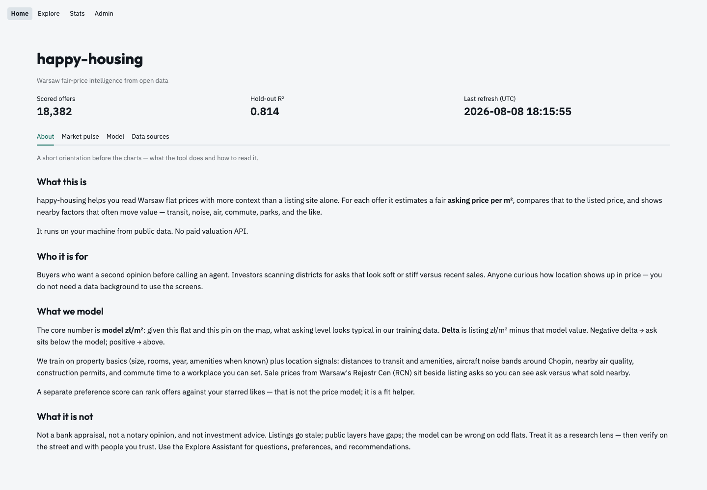

## Who it is for

- **Buyers & renters** — compare listing price to a model “fair” price and inspect what drives the gap (metro vs sirens vs pollution).
- **Investors** — spot districts where planned infrastructure may lift value, or where multi-year construction may hurt comfort.
- **Analysts & researchers** — reproducible Warsaw housing pipeline on free public data, no paid map or valuation APIs.

## App tour

Streamlit multipage UI: **Home · Explore · Stats · Admin**.

### Home

Default **About** tab (purpose, Explore Assistant, how to read the numbers),
then market pulse charts, model hold-out metrics, and open-data source inventory.

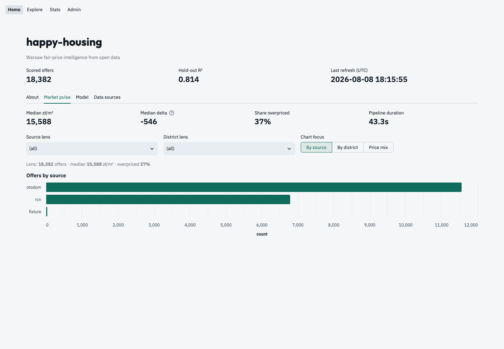

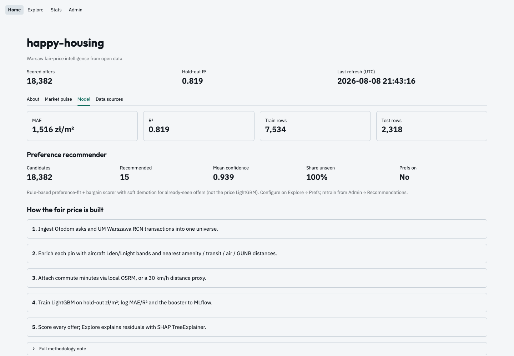

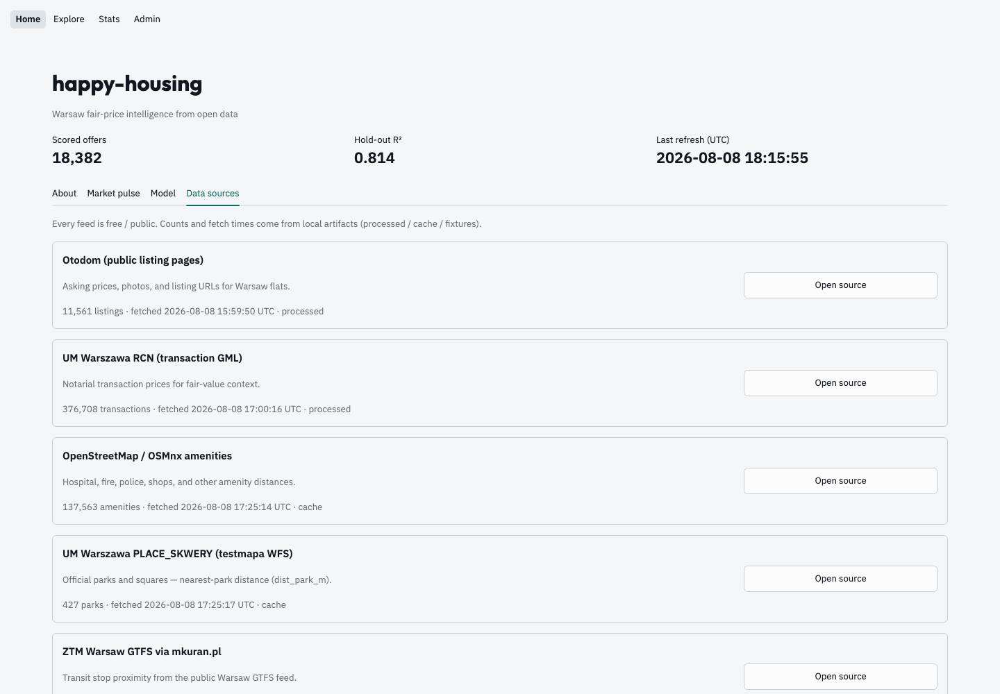

### Explore

Sidebar filters + map overlays. **Map / Spatial / Offer / Board / News / Chat / Prefs**:

- **Map** — underpriced (green) vs overpriced (red) pins, OOU/noise, continuous
  GIOŚ air-quality IDW field, transit, amenities
- **Offer** — deep dive (Overview · Context · Map · Explain · AI review), star watching
- **Board** — filterable table; row click opens Offer
- **News** — field changes on starred offers
- **Chat** — LMS Assistant (also **Assistant** popover): search/recommend, prefs, stars, web opinions, open offers; conversations persist and reload

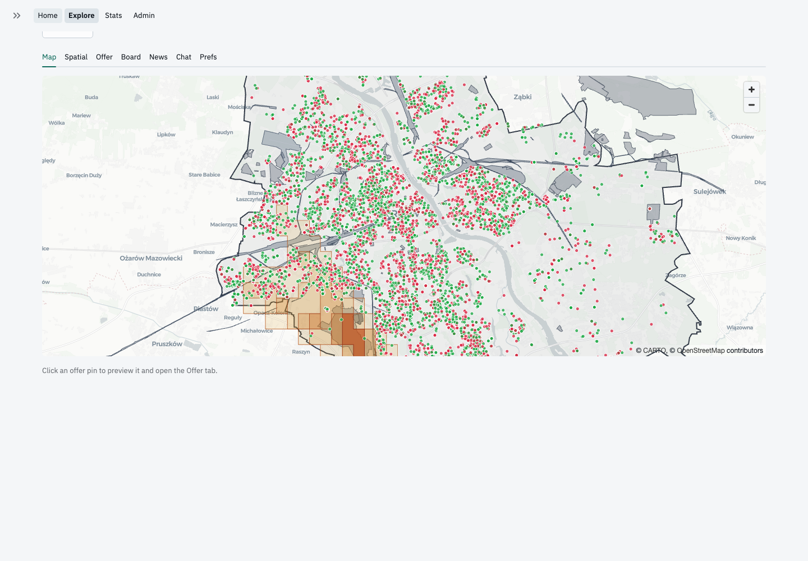

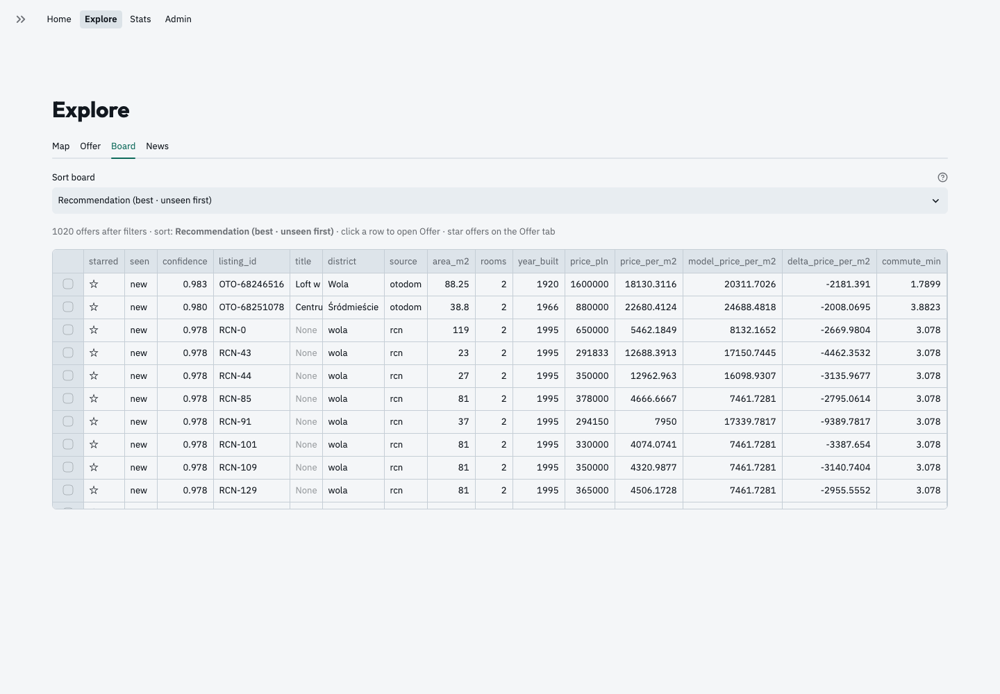

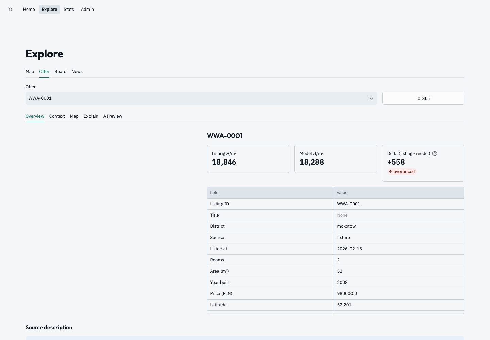

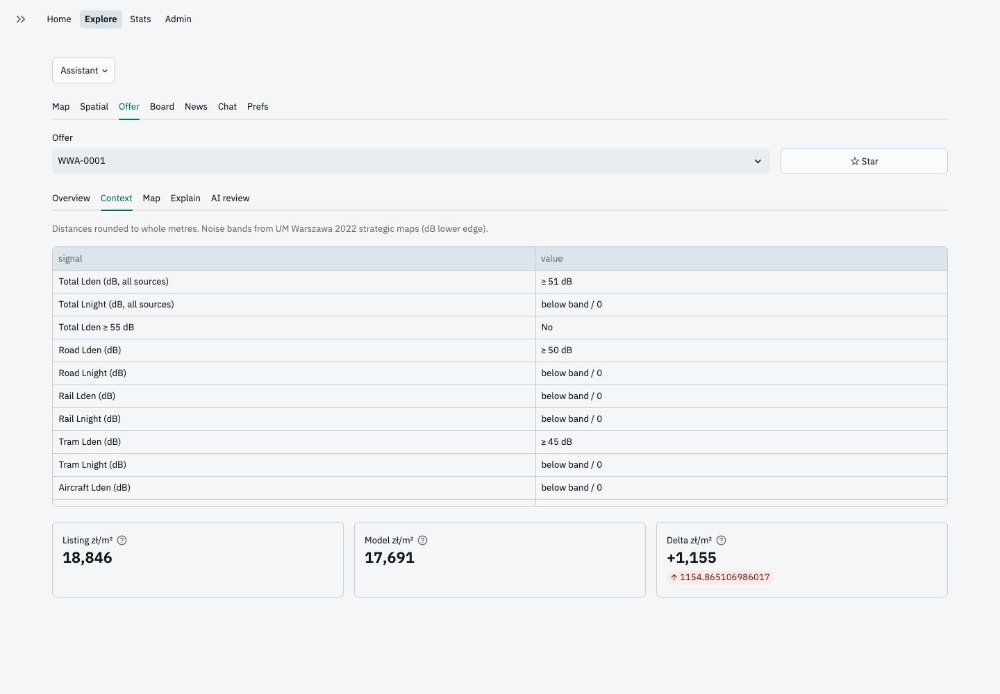

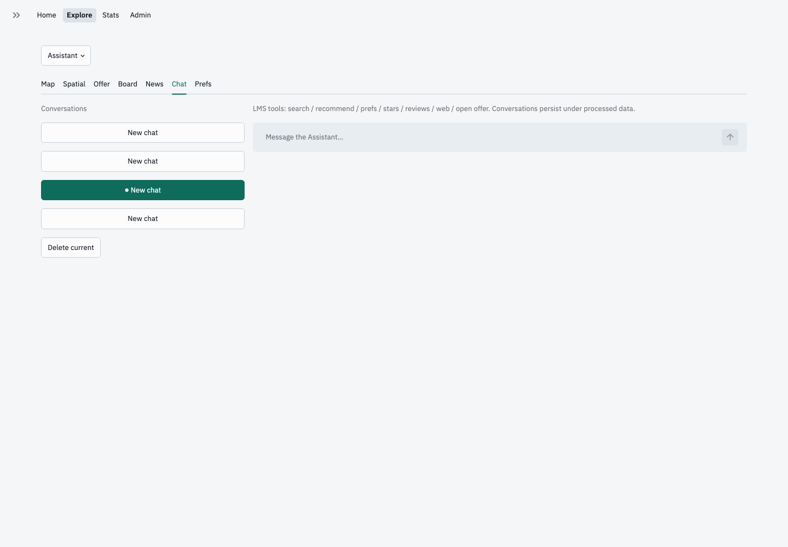

### Stats

Filterable market analytics for decisions — not a vanity dashboard:

- **Sidebar filters** — districts, sources, months, valuation, aircraft / total noise ≥55 dB, price / area / rooms
- **Overview** — inventory mix, primary vs secondary, budget ladder
- **Market** — trends, residual pressure, district value board, ask vs RCN ink, hunt / watch
- **Livability** — UM noise premiums (total + sources), commute / transit / metro / bike, parks / traffic / zones / AQI
- **Stock** — size / rooms / build-era mix
- **Model** — LightGBM gain importance, global mean |SHAP|, example offer explanation

Tunables: Admin → Stats (including SHAP sample size).

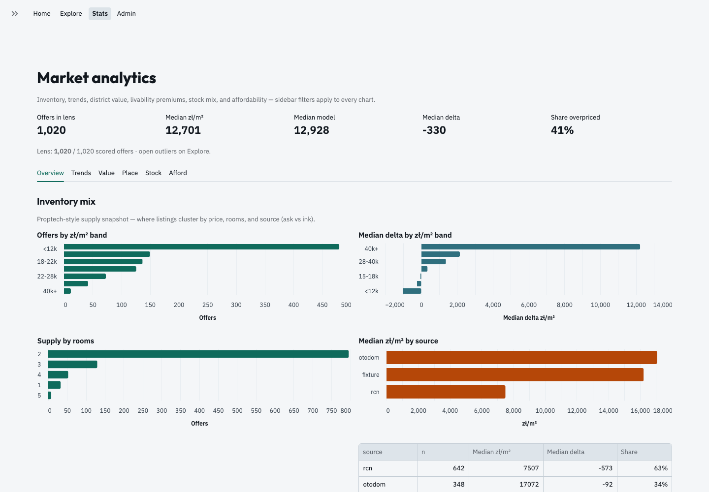

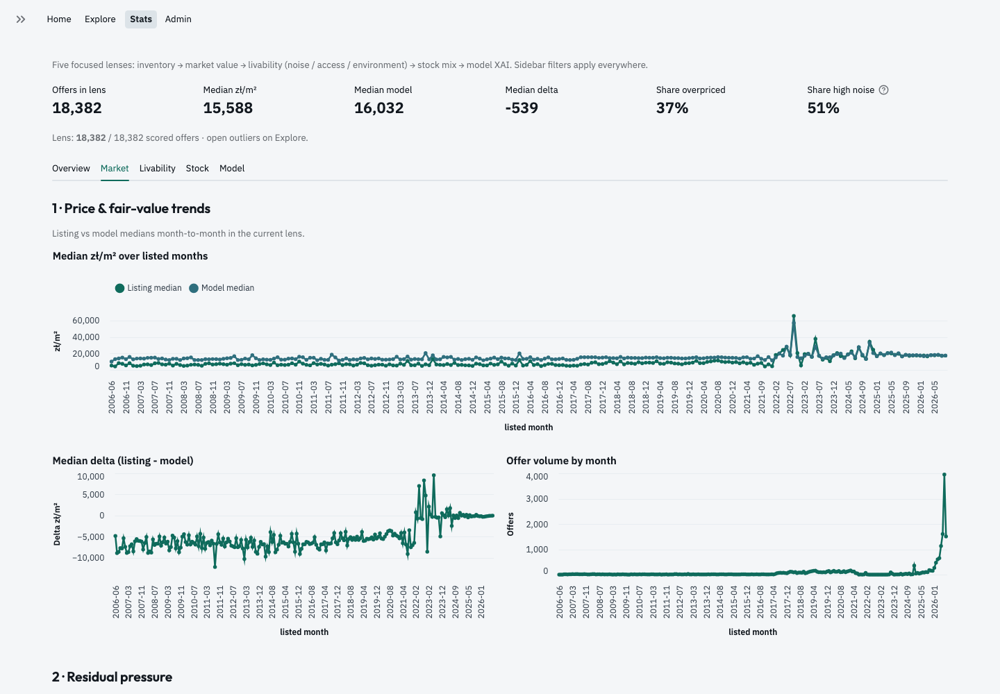

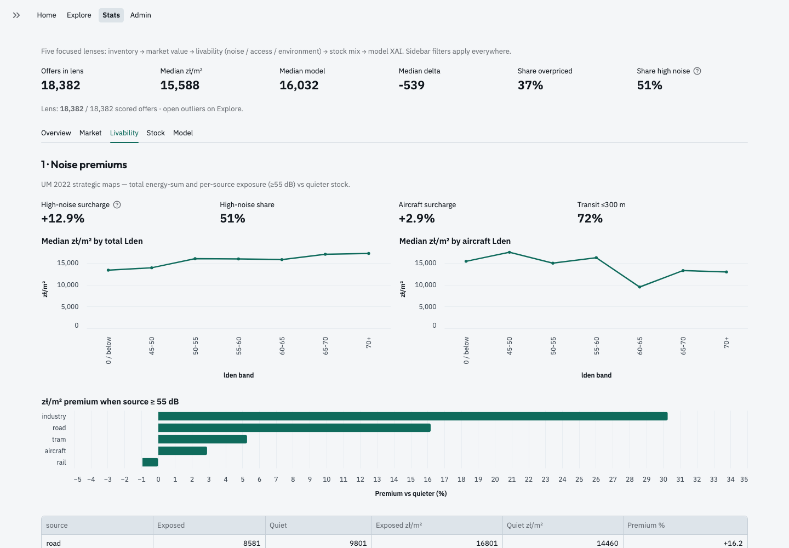

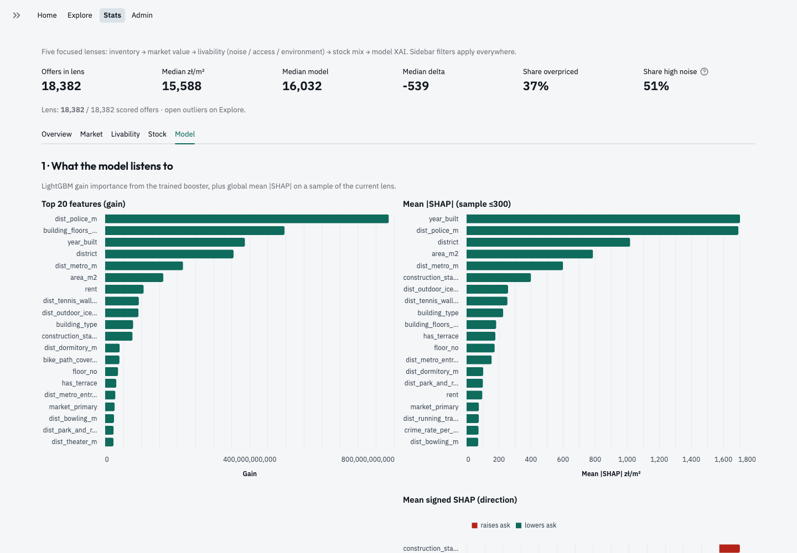

### Admin

Left section list (Overview · Commute · Run · Sources · …) — one short panel at
a time for scrape, retrain, AI, and memory. No raw JSON dump.

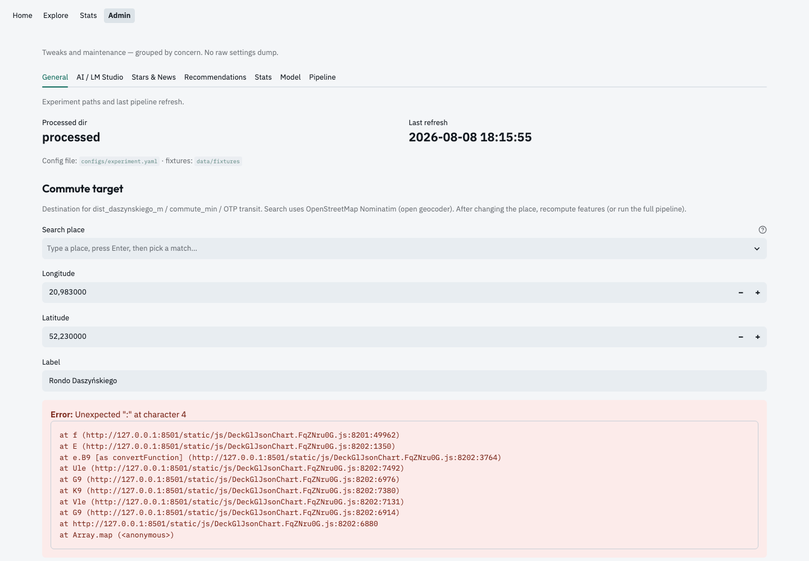

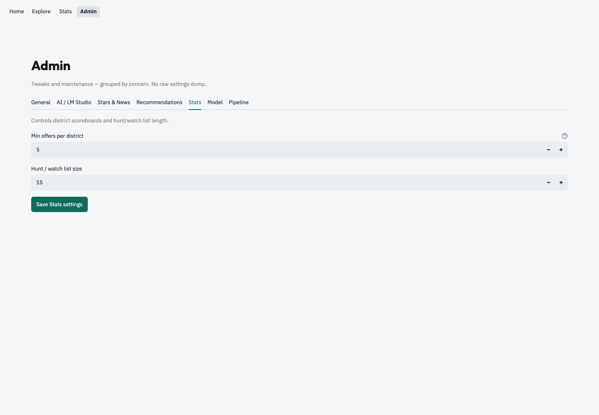

Refresh screenshots after UI changes (app must be running):

```bash
make app
uv run python scripts/capture_readme_screenshots.py
```

## What you get

| Capability | Business value |
|------------|----------------|
| Live / recent listings + official transaction prices | Market asking vs what people actually paid nearby |
| Spatial livability layers | Noise (emergency services, airport OOU), air quality, construction, planned transit |
| Commute & transit context | Access to the city core and ZTM frequency, not just “distance to stop” |
| Fair-price model | Estimated zł/m² from location and property features (LightGBM + SHAP) |
| Preference recommender | Learn from starred offers; retrain from Admin |
| Time-aware map overlays | Transit at a chosen hour, traffic proxy, amenity layers |

## Motivation

Warsaw’s housing market moves fast, and public portals show asking prices without the spatial context that drives comfort and long-term value. Commercial valuators and paid APIs are expensive or opaque. Meanwhile the city and state publish rich free data — Rejestr Cen (RCN), ZTM schedules, GIOŚ air quality, GUNB permits, OpenStreetMap — that almost never land in one buyer-facing tool.

`happy-housing` exists to close that gap: **one local, zero-paid-API stack** that answers “Is this flat overpriced for this street?” and “What will change here in the next few years?”

## Methodology (high level)

1. **Ingest** — Listings and official transaction / transit / environmental feeds into local files.
2. **Enrich** — Vectorized GIS features (distances, zone flags, air stations, permits, routing) on every property.
3. **Store** — Columnar GeoParquet + in-process DuckDB (no external database server).
4. **Model** — Tabular regressor on zł/m²; explain predictions with SHAP; optional preference recommender.
5. **Present** — Streamlit: Home pulse, Explore map/offer/board, Stats oddities, Admin controls.

Principles: **free/open sources only**, **spatial vectorization**, **local compute** for cost and privacy.

Roadmap and technical phases: [docs/plan.md](docs/plan.md).

## Status

Working local app: ingest → GIS enrich → LightGBM score → Streamlit GUI (Home / Explore / Stats / Admin). Fixtures keep tests offline; live Otodom / RCN / GTFS / GIOŚ pulls available via Admin or `make pipeline`.

## Quick start

```bash
make install
make check
make pipeline   # or Admin → Pipeline / Otodom scrape
make app        # http://127.0.0.1:8501 — theme/server in `.streamlit/config.toml`
```

Edit `configs/experiment.yaml` for run metadata and MLflow settings. App UX / `runOnSave` / bind address live in `.streamlit/config.toml`.

```bash
make mlflow          # optional local tracking UI
make help            # all targets
```

```python
from pathlib import Path
from happy_housing.config import load_experiment_config

config = load_experiment_config(Path("configs/experiment.yaml"))
```

## Repository layout

| Path | Purpose |
|------|---------|
| `src/happy_housing/` | Ingest, GIS, storage, models, app |
| `configs/` | Experiment YAML |
| `.streamlit/config.toml` | Streamlit theme + local server (`runOnSave`, port, …) |
| `data/fixtures/` | Small committed samples (raw dumps stay local / gitignored) |
| `docs/plan.md` | Phased plan |
| `docs/screenshots/` | README UI captures |
| `scripts/capture_readme_screenshots.py` | Refresh screenshots (app running) |
| `tests/` | Pytest |

## License

Apache License 2.0. See [LICENSE](LICENSE).

Copyright 2026 Paweł Pozorski.
