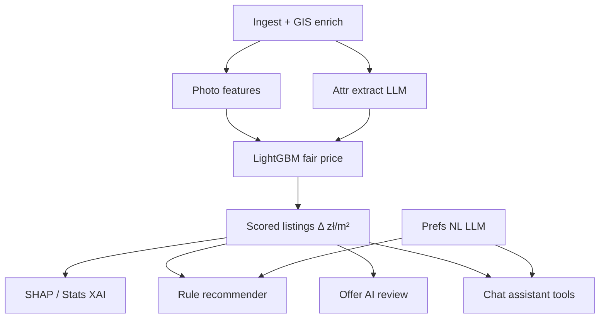

# Modeling & AI systems

Technical reference for every model- and LLM-driven component in
**happy-housing**. These pages describe motivation, methodology, training or
prompt data, search spaces, where the Streamlit app surfaces each system, and
performance characteristics as implemented in `src/happy_housing/`.

In-app short form: **Home → Model** (and Assistant `get_methodology`).
Tunables: **Admin** sections linked below. Experiment YAML:
[`configs/experiment.yaml`](../../configs/experiment.yaml). Persisted app knobs:
`data/processed/app_settings.json` (`AppSettings`).

## System map

## Documents

| Doc | System | Kind | Admin section |
|-----|--------|------|---------------|
| [Fair-price LightGBM](fair-price.md) | Asking zł/m² regressor + HPO + calibration | Supervised GBDT | Price model |
| [Explainability (SHAP)](explainability.md) | Per-offer + global XAI | TreeExplainer | Stats |
| [Recommender](recommender.md) | Bargain / commute ranking | Rule blend | Recommendations |
| [Offer AI review](offer-ai.md) | Buyer-facing listing review | Local LMS LLM | Offer AI |
| [Chat assistant](assistant.md) | Tool-calling agent | Local LMS + tools | Assistant |
| [Attribute extract](attribute-extract.md) | Description → structured fields | Local LMS LLM | Extract |
| [Photo CV](photo-cv.md) | Listing image features | CLIP / heuristic | Price model |
| [Preference NL](preference-nl.md) | Free-text → Explore prefs JSON | Local LMS LLM | (Explore Prefs) |

## Design principles

1. **Local-first** — LightGBM and LM Studio run on-machine; no paid valuation APIs.
2. **Ask labels vs deed comps** — by default Otodom/fixture asks train the price
   model; UM Warszawa RCN deeds feed neighborhood features, not ask targets.
3. **Honest deltas** — scored `delta_price_per_m2` uses out-of-fold predictions
   on train labels where possible (`oof_predict_price_per_m2`).
4. **Separate recommender** — ranking is not the LightGBM; it consumes model
   deltas plus commute / prefs / impressions.
5. **Admin-tunable** — HPO metric, LLM models/prompts, recommender weights live
   in Admin; never dump raw settings JSON in the UI.

## Where metrics live

| Surface | What you see |
|---------|----------------|
| Home → Model | Last pipeline hold-out metrics (`test_*`) from run metadata |
| MLflow (`make mlflow`) | Per-run params, `val_*` / `test_*`, IDW baseline, artifacts |
| Stats → Model | LightGBM gain importance + mean \|SHAP\| on a sample |
| Admin → LMS metrics | LLM call counts / errors by purpose |

Typical **target** stated in Admin copy is **≤1% test MAPE** on zł/m² after
log-target + district calibration. Realized numbers depend on scrape size,
feature completeness, and HPO budget — always read the latest Home / MLflow
run rather than this doc for a live scorecard.
