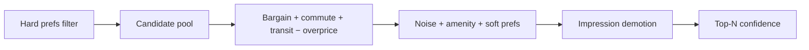

# Recommendation system

Ranks buyer-facing listings for Explore **News**, Board sort, map recommended
pins, and Chat `recommend_offers`.

**Code:** `src/happy_housing/app/recommender.py`, `board_sort.py`,
`preferences.py`  
**State:** `data/processed/recommender_impressions.json`,
`recommender_metrics.json`  
**Admin:** Recommendations

> **Important:** This is a **deterministic rule blend**, not a second LightGBM
> or collaborative filter. README “learn from starred” means impression
> demotion + prefs — not gradient training on stars.

---

## Motivation

Fair price alone does not decide “what should I look at next?” Buyers want:

- Bargains relative to the model (negative Δ),
- Acceptable commute / transit,
- Soft amenity polarity (near parks / far highways),
- Soft demotion of already seen, opened, or skipped cards,

without waiting for a personalized ML retrain on sparse feedback.

---

## Methodology

### Pipeline

1. **Hard filters** — when Explore prefs `enabled`, `apply_preferences`
   (price, area, rooms, districts, commute cap, sources, …).
2. **Default pool** — if prefs sources empty and
   `recommender_otodom_pool_default`, keep `source ∈ {otodom, fixture}`.
3. **Base score** (clipped to \[0, 1\]):

\[
\begin{aligned}
\text{bargain} &= \mathrm{clip}_{[0,1]}(\max(-\Delta,0) / s_\Delta) \\
\text{overprice} &= \mathrm{clip}_{[0,1]}(\max(\Delta,0) / s_\Delta) \\
\text{commute} &= \mathrm{clip}_{[0,1]}(1 - c / c_{\max}) \\
\text{transit} &= \mathrm{clip}_{[0,1]}(1 - d_{\mathrm{stop}} / d_{\max}) \\
\text{base} &= w_b\cdot\text{bargain} + w_c\cdot\text{commute} + w_t\cdot\text{transit} \\
&\quad - w_o\cdot\text{overprice} + \text{noise} + \text{amenity} + \text{soft}
\end{aligned}
\]

Defaults: \(w_b=0.50\), \(w_c=0.25\), \(w_t=0.20\), \(w_o=0.15\);
\(s_\Delta=\) `recommender_delta_scale_zl` (2000 zł/m²);
amenity proximity soft-cap `recommender_dist_cap_m` (2000 m).

4. **Demotion:**

\[
\text{confidence} = \frac{\text{base}}{1 + \alpha\cdot n_{\mathrm{seen}}
  + p_{\mathrm{open}}\cdot\mathbb{1}_{\mathrm{opened}}
  + p_{\mathrm{skip}}\cdot\mathbb{1}_{\mathrm{skipped}}}
\]

Defaults: \(\alpha=1\), \(p_{\mathrm{open}}=0.5\), \(p_{\mathrm{skip}}=3\).

5. **Retrain** (`retrain_recommender`) = rescore universe + write metrics JSON
   (no booster file).

### Inputs

| Signal | Column / store |
|--------|----------------|
| Model Δ | `delta_price_per_m2` |
| Commute | Mode from Admin (`commute_display_mode`) |
| Transit | `dist_transit_stop_m` |
| Amenity weights | `recommender_amenity_weights` (−1…+1 per catalog type) |
| Prefs | `preferences.json` |
| Impressions | counts / opened / skipped per `listing_id` |

---

## Hyperparameters (Admin)

All persisted in `AppSettings`:

| Knob | Default | Role |
|------|---------|------|
| `recommender_top_n` | 15 | News / chat limit |
| `recommender_demotion_alpha` | 1.0 | Seen-count strength |
| `recommender_w_*` | 0.50 / 0.25 / 0.20 / 0.15 | Term weights |
| `recommender_delta_scale_zl` | 2000 | Bargain/overprice saturation |
| `recommender_dist_cap_m` | 2000 | Amenity proximity scale |
| `recommender_opened_penalty` | 0.5 | Opened demotion |
| `recommender_skipped_penalty` | 3.0 | Skipped demotion |
| `recommender_otodom_pool_default` | True | Buyer pool when prefs empty |
| Amenity table | 0 | Per-type polarity |

No discrete HPO grid — weights are user-set.

---

## Metrics

`recommender_metrics.json` after retrain / recorded top-N:

- `n_candidates`, `n_recommended`
- `mean_confidence`, `share_unseen`
- `prefs_enabled`, `refreshed_at`

These measure ranking health, not zł/m² accuracy.

---

## App surfaces

| Place | Behaviour |
|-------|-----------|
| Explore → News | `top_recommendations` cards; skip / star refresh |
| Explore → Board | Default sort by confidence |
| Explore → Map | Optional recommended pin styling |
| Chat | `recommend_offers` tool |
| Admin → Recommendations | Save weights, retrain, clear memory |

---

## Performance

- Pure pandas vectorization over the filtered frame — typically **tens of ms**
  for a few thousand rows.
- Map recommended-id memo (`recommended_pins_memo_key`) avoids rescoring on
  every pin click when prefs / weights / scored mtime unchanged.
- Impression writes are small JSON merges on disk.

---

## Relation to the price model

Recommender **consumes** LightGBM deltas; it does not replace them. Changing
Admin Price model settings requires a **pipeline** retrain; changing
recommender weights only needs Admin → Retrain recommendation model (or the
next News impression cycle).
