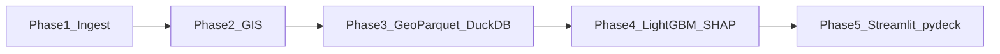

# Phased Real Estate AI Analyzer (validated stack)

## Agent quality gates (every phase)

Follow load order from [AGENTS.md](AGENTS.md):

1. Exit = `make check` (prek/ruff/mypy/pytest)
2. Skill **caveman ultra** for chat; normal prose for code/commits/PRs
3. [.cursor/rules/*.mdc](.cursor/rules/) — especially:
   - **tdd.mdc** — red → green → refactor before each feature commit
   - **python-quality.mdc** — types, Google docstrings, module docstrings, logging (no print)
   - **performance.mdc** — vectorize GIS; stream/batch; no bulk materialize
   - **minimal-diff.mdc** — task-only changes
   - **experiment-boundaries.mdc** — code in `src/happy_housing/`, configs YAML + `ExperimentConfig` sync
   - **uv-workflow.mdc** — `uv sync` / `uv lock`; prek not pre-commit
   - **git-commits.mdc** — granular `feat`/`fix`/`test`/`chore`/`build`; propose → approve (except this Phase 0 batch user already approved)
4. Skill **happy-housing-development** (after rename) — Read → Red → Green → Refactor → Validate → Hand off
5. Skills when relevant: `python-tdd-with-uv`, `writing-tests`, `writing-commit-messages`, `deslop` before hand-off

No new markdown unless asked (exception: checked-in plan under `docs/plan.md` once in Phase 0). No paid deps. No force-push/amend unless rules allow.

---

## Validation verdict (web research Aug 2026)

Optimize: **$0 APIs**, **local CPU/RAM**, **max open data**, **fast filter/map/train**.

### Keep

| Choice | Why |
|--------|-----|
| GeoPandas `sjoin` / distance | Vectorized spatial ops |
| OSMnx (cached city extract) | Amenities → GeoDataFrame |
| DuckDB + spatial + GeoParquet 1.1 | No server; Hilbert + bbox prune |
| LightGBM + shap TreeExplainer | Fast tabular + waterfall XAI |
| Streamlit + pydeck | Local GUI; maintained map path |
| GIOŚ API **v1** | Free; legacy `/rest/` retired |
| UM Warszawa RCN GML/WFS | Free transaction prices (2026) |
| GTFS [mkuran.pl/gtfs/warsaw.zip](https://mkuran.pl/gtfs/warsaw.zip) | Public Warsaw feed + attribution |
| GUNB RWDZ WFS (+ CSV) | Free permits |

### Replace

| Drop | Why | Use instead |
|------|-----|-------------|
| Zametr API | No public free API | UM RCN GML |
| Public ORS bulk | Limits / cost-at-scale | Local OSRM Docker |
| ORS for transit | Car ≠ ZTM | OTP2 + GTFS; GTFS proxy interim |
| streamlit-keplergl | Unmaintained static | pydeck + Streamlit slider |
| ScrapingAnt scrapers | Paid | Own Otodom client; optional adapter |
| mllm-shap | Unnecessary | shap |

### Locked identity (Phase 0 tokens)

| Token | Value |
|-------|-------|
| `__PROJECT_SLUG__` | `happy-housing` |
| `__PROJECT_MODULE__` | `happy_housing` |
| `__GITHUB_OWNER__` | `Pawlo77` |
| `__AUTHOR_NAME__` | `Paweł Pozorski` |
| `__AUTHOR_EMAIL__` | `pozorski.paul@gmail.com` |
| `__AUTHOR_FIRST_NAME__` | `Paweł` |
| `__AUTHOR_LAST_NAME__` | `Pozorski` |
| `__AUTHOR_AFFILIATION__` | `Independent` |
| `__COPYRIGHT_YEAR__` | `2026` |
| `__PROJECT_DESCRIPTION__` | see below |

**GitHub repository description** (About + `pyproject.toml` `description` + README blurb):

> Warsaw real-estate AI analyzer: free GIS enrichment (OSMnx, RCN, GTFS, GIOŚ), LightGBM fair-price model with SHAP, Streamlit/pydeck heatmap — DuckDB + GeoParquet, zero paid APIs.

**Homepage/URLs:** `https://github.com/Pawlo77/happy-housing`

---

## Target layout

```
src/happy_housing/
  config.py
  ingest/ gis/ storage/ models/ app/
data/fixtures/   # committed
data/raw/ processed/  # gitignored
docker/          # OSRM (+ optional OTP)
docs/plan.md     # this plan (Phase 0)
configs/experiment.yaml
tests/
```



---

## Phase 0 — Plan commit + template rename + GitHub About

**Goal:** stop being a template; identity + description live in git and on GitHub.

**Commits (user-approved batch):**
1. `docs: add phased real-estate AI implementation plan` — copy validated plan → [`docs/plan.md`](docs/plan.md)
2. `chore: replace template tokens with happy-housing identity` — rename `src/__PROJECT_MODULE__` → `src/happy_housing`, skill folder → `happy-housing-development`, replace all tokens in pyproject/README/AGENTS/rules/tests/LICENSE/report; strip template banner from README; set description string above
3. `chore: set GitHub repo description` — `gh repo edit --description "..."`
4. Optional same session if still green: `build: add gis/ml/app optional dependency groups` (or defer to start of Phase 1)

**Exit:** `make install && make check`; CI no longer skips on `__PROJECT_SLUG__`; `gh repo view` shows description.

---

## Phase 1 — Ingest

Fixtures → RCN GML → mkuran GTFS → Otodom client → optional scraper adapter. TDD per loader. Tiny fixtures only in git.

**Commits:** listing fixtures; RCN GML→parquet; GTFS→stop parquet; Otodom rate-limited client; optional adapter; ingest tests.

## Phase 2 — GIS

Cached osmnx; OOU sjoin; metro/construction; GUNB; GIOŚ v1; OSRM matrix; OTP or GTFS proxy. No per-point Overpass; no public ORS bulk. Vectorize only.

## Phase 3 — Storage

Hilbert-sorted GeoParquet 1.1 + bbox; DuckDB spatial query API; filter tests.

## Phase 4 — ML + XAI

Feature matrix; LightGBM price/m²; SHAP Explanation; MLflow; smoke tests; optional CatBoost compare later.

## Phase 5 — GUI

Streamlit shell; offer delta metrics; SHAP waterfall; pydeck layers; time-slider heatmap; business tooltips.

---

## Cross-cutting

- Propose commits unless already approved (Phase 0 approved here)
- YAML + `ExperimentConfig` same change set
- Attribution footers when GUI lands
- Offline CI via fixtures; `make ingest-*` for network

## Build order

Phase 0 (now) → 1 fixtures+RCN+GTFS → 2 osmnx+OOU → 3 storage → 4 ML → 5 GUI → backfill live Otodom/OSRM/OTP/GUNB/time heatmap.

---

## Implementation status (2026-08-08)

| Phase | Status | Notes |
|-------|--------|-------|
| 0 Identity + plan | **Done** | `happy_housing`, GitHub About, `docs/plan.md` |
| 1 Ingest | **Done** | Fixtures, Otodom, RCN GML, GTFS, GIOŚ, GUNB; unlimited caps |
| 2 GIS | **Done** | Full OSM amenity/shop tags, OOU, distances, OSRM + OTP clients (Docker), GTFS hour proxy |
| 3 Storage | **Done** | Hilbert-sorted GeoParquet + bbox; DuckDB spatial queries |
| 4 ML + XAI | **Done** | LightGBM + SHAP + MLflow; optional CatBoost compare |
| 5 GUI | **Done** | Streamlit/pydeck, hour slider, hover help, Admin, Prefs, Stats |

**Ops knobs:** `routing.use_otp_transit` in `configs/experiment.yaml` (default `false` — enable when OTP Docker is up). OSRM auto-falls back to 30 km/h distance proxy when down.
